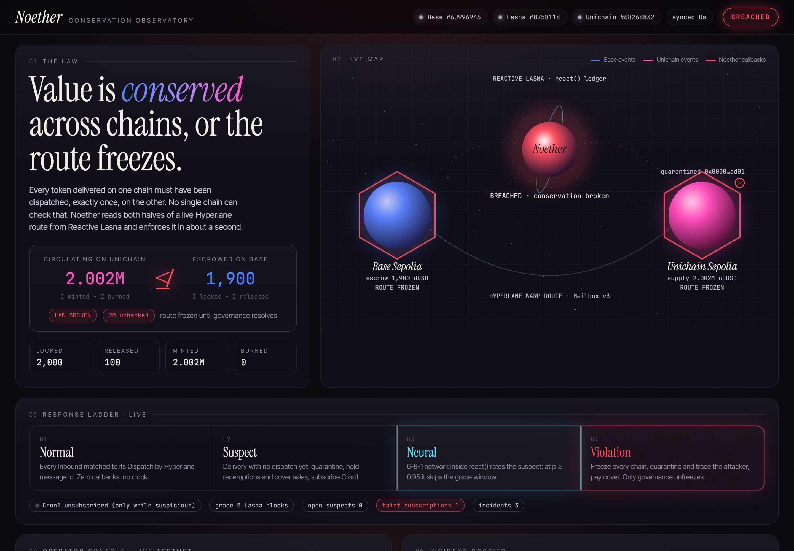

# Noether

**Reactive Omni Buildathon 2026** · Tracks: *Every Second Counts* and *Reactive Meets AI* · Live observatory: [`app/`](app/) · Evidence: [docs/LIVE_EVIDENCE.md](docs/LIVE_EVIDENCE.md) · Code: [github.com/s70239176-ctrl/noether](https://github.com/s70239176-ctrl/noether)



**A conservation law for a real Hyperlane Warp Route, enforced by Reactive Omni.**

> Every token message delivered on one chain was dispatched, exactly once, on the other.

A bridge is only as safe as the thing that says "this message is real": a relayer key, a validator set, or a proof verifier. When that thing fails, the bridge happily mints tokens nobody locked, or releases collateral nobody burned. That is the shape of the largest bridge losses: Ronin, Harmony and Multichain (keys compromised), Wormhole (verification bypassed, about 120k wETH minted with nothing behind it), and Nomad (releases with no burn, then hundreds of copycats). No single chain can catch it, because each chain sees only its own half of the ledger.

**Noether** is a reactive contract on Reactive Lasna that sees both halves. It watches Hyperlane's live `Mailbox.Dispatch` on one chain and the delivery on the other. It matches them by **Hyperlane message id**, which is identical on both chains. When a delivery has no dispatch behind it, Noether does all of this **in one reactive transaction**:

1. freezes the route on **every** chain (inbound messages rejected, bridging out blocked),
2. quarantines the recipient and **follows the money** by subscribing to the recipient's transfers inside `react()`,
3. closes cover sales and **pays policyholders automatically**, excluding anyone who bought cover after the forged message.

Noether doesn't trust the bridge's security module. It audits the bridge's results.

Reactive Omni Buildathon entry. Tracks: **Every Second Counts** (primary) and **Reactive Meets AI** (an on-chain neural scorer inside `react()` decides whether to skip the grace window).

> **Status: live on testnet.** Deployed on Base Sepolia, Unichain Sepolia and Reactive Lasna against Hyperlane's live Mailboxes, and attacked live: a forged 1,000,000 mint through Hyperlane's real Mailbox froze both chains in **1 to 2 seconds** and paid cover in **3 seconds**, with no keeper, bot or human. See [Live evidence](#live-evidence) and [docs/LIVE_EVIDENCE.md](docs/LIVE_EVIDENCE.md). 31 tests run on Hyperlane's real `Mailbox`, `TrustedRelayerIsm`, `HypERC20Collateral` and `HypERC20`.

---

## The bridge: a real Hyperlane Warp Route

| Piece | Contract | Origin |
|---|---|---|
| Base Sepolia Mailbox | `0x6966b0E55883d49BFB24539356a2f8A673E02039` | Hyperlane, live (registry) |
| Unichain Sepolia Mailbox | `0xDDcFEcF17586D08A5740B7D91735fcCE3dfe3eeD` | Hyperlane, live (registry) |
| Collateral router (Base) | `HypERC20Collateral` | Hyperlane `@hyperlane-xyz/core@12.2.0`, unmodified |
| Synthetic router (Unichain) | `NoetherHypERC20` = `HypERC20` + one ERC-20 hook (quarantine, no bridging out while frozen) | Hyperlane + one ERC-20 hook |
| Route security module | `NoetherIsm` wrapping Hyperlane's `TrustedRelayerIsm` | Hyperlane's own per-route ISM extension point |
| Hooks | Hyperlane `MerkleTreeHook` | live (registry) |

**How Noether plugs in without forking Hyperlane.** `Mailbox.process` records the processor, then calls the recipient router's ISM (`verify`), then calls the router's `handle`, which mints or releases. `NoetherIsm` *is* that ISM. In [`verify`](src/hyperlane/NoetherIsm.sol:74) it:
- rejects everything while Noether has frozen the route, and releases while Noether holds the collateral side,
- rejects messages paying a quarantined account,
- delegates real verification to the inner ISM,
- emits `Inbound(messageId, origin, recipient, amount, timestamp)`. If `handle` reverts, the whole `process` reverts, so an `Inbound` log always means tokens really moved.

**Why `TrustedRelayerIsm` is the demo's inner ISM.** It's a real Hyperlane ISM: only one relayer key may deliver. That makes "the key is compromised" a real, reproducible attack. The key hand-builds a message "from" the enrolled home router, and **Hyperlane's real Mailbox accepts it** and mints. Noether works the same with any inner ISM (multisig, aggregation, ZK) because it never relies on it.

---

## Verify it in 5 minutes

```bash
git clone --recursive <this repo> && cd noether && npm ci --ignore-scripts   # Hyperlane contracts
forge test                    # 31 tests on Hyperlane's real Mailbox / ISM / routers
python model/train.py         # regenerates the neural weights bit for bit (needs numpy)
git diff --exit-code src/reactive/NoetherBrainWeights.sol
bash script/rehearse.sh       # full deployment on 3 local nodes with real Hyperlane Mailboxes
```

| What | Where |
|---|---|
| The law and the response ladder | [NoetherLedger.sol](src/reactive/NoetherLedger.sol): `react()` line 208, `_onDispatch` 238, `_onInbound` 275 |
| Noether as the route's ISM | [NoetherIsm.sol:74](src/hyperlane/NoetherIsm.sol:74) |
| Callback authentication | `onlyNoether` in [NoetherGuarded.sol:64](src/guard/NoetherGuarded.sol:64): callback proxy **and** injected reactive-contract address |
| The attack, end to end | `test_ForgedWhaleMintFreezesInTheSameReaction` in [test/NoetherLoop.t.sol](test/NoetherLoop.t.sol) |

The test harness ([test/utils/NoetherHarness.sol](test/utils/NoetherHarness.sol)) runs one real Hyperlane `Mailbox` per domain in a single EVM and plays three off-chain roles:
- **Hyperlane relayer:** it calls `Mailbox.process` with the real dispatched bytes.
- **Reactive Network:** a log reaches `react()` only if a live subscription matches it, so the dynamic subscriptions are really exercised.
- **Callback proxy:** it delivers callbacks with the sender address injected into the first argument.

---

## The Observatory: run the whole idea live

[`app/`](app/) is a live frontend for the deployed system. It reads Base Sepolia, Unichain Sepolia and Reactive Lasna directly and, in operator mode, drives every scenario on the real testnets.

| Panel | What it shows, live |
|---|---|
| **The law** | `circulating ≤ escrowed`, rebuilt by the Lasna ledger from both chains; turns into a glitching `≰` on a breach |
| **Live map** | Base, Lasna and Unichain as bodies. Hyperlane messages travel the warp-route arc, logs stream into Noether, callbacks fire back as red bolts, and frozen routes get a hexagonal cage |
| **Response ladder** | which rung the ledger is on, whether `Cron1` is currently subscribed, open suspects, live taint subscriptions |
| **Operator console** | one-click *honest transfer*, *forged mint*, *collateral drain*, *copycat* and *governance resolve*, streamed step by step with explorer links |
| **Incident dossier** | the latest violation as a timeline (origin tx → Lasna reaction → each freeze landing → payout), seconds taken from on-chain timestamps, and callbacks landed vs requested |
| **Neural scorer** | the 6-8-1 network with the exact on-chain weights; drag the six features and see the same integer forward pass `react()` runs |
| **Cover · economy** | sales open / paused / closed, capital, payouts and exclusions, ledger REACT balance, operator wallet |
| **Seismograph** | every event on all three chains over the last 30 minutes, each one linking to its transaction |

```bash
cd app && npm ci && npm run dev     # http://127.0.0.1:5173
```

**Operator mode** is on when `../.env` holds the deployer key. The key stays in the local server process and never reaches the browser; actions need a same-origin request, and only one runs at a time. **Watch-only mode** (`NOETHER_OPERATOR=0`, or no key) shows everything except the buttons, which is the safe way to host it publicly. `npm run build && npm start` serves the production build.

## How it works

```mermaid
flowchart LR
  subgraph Base["Base Sepolia (collateral)"]
    BR[HypERC20Collateral] -- transferRemote --> BM[Hyperlane Mailbox<br/>Dispatch]
    BM2[Mailbox.process] --> BG[NoetherIsm<br/>Inbound] --> BR
    C[NoetherCover<br/>PayoutBatch]
  end
  subgraph Uni["Unichain Sepolia (synthetic)"]
    UM2[Mailbox.process] --> UG[NoetherIsm<br/>Inbound] --> UR[NoetherHypERC20]
    UR -- transferRemote --> UM[Hyperlane Mailbox<br/>Dispatch]
  end
  subgraph Lasna["Reactive Lasna"]
    L[NoetherLedger.react()<br/>ledger keyed by Hyperlane message id<br/>+ neural scorer]
  end
  BM -- Dispatch --> L
  UG -- Inbound --> L
  UM -- Dispatch --> L
  BG -- Inbound --> L
  C -- PayoutBatch --> L
  L -- hold / freeze --> BG
  L -- hold / freeze / settleBatch --> C
  L -- quarantine / freeze --> UG
```

Subscriptions: `Dispatch` on each Mailbox **filtered by `sender = route router`** (topic 1), so other apps on the same busy Mailbox cost nothing (`test_OtherRoutesOnTheSameMailboxAreIgnored`), plus `Inbound` on each guard and `PayoutBatch` on cover.

### The response ladder

| Rung | Trigger | What Noether does | Reversible? |
|---|---|---|---|
| **Suspect** | `Inbound` whose message id has no `Dispatch` seen yet | quarantine the recipient, hold the collateral side's releases, pause cover sales, **subscribe to `Cron1` inside `react()`** | yes, automatically |
| **Neural** | on-chain scorer, same reaction | if p ≥ 0.95, skip the grace window | n/a |
| **Cleared** | the matching `Dispatch` arrives within `GRACE_BLOCKS` | unquarantine, lift holds, **unsubscribe `Cron1`** | n/a |
| **Violation** | duplicate delivery, field mismatch, or grace timeout | freeze both guards + cover, quarantine, **subscribe to the recipient's `Transfer`s**, start the payout loop | governance only |

Hyperlane already rejects plain replays (`delivered[id]`) and cross-chain replays (destination is bound into the message); see `test_HyperlaneRejectsCrossChainReplayNatively`. Noether covers what's left: a message that verification wrongly accepted.

### Surgical, not a sledgehammer

During a freeze, honest holders keep transferring on the spoke. What stops is inbound minting, bridging out (the redemption path), and the specific accounts involved. Noether never moves user funds and never unfreezes anything itself.

### Taint tracing with dynamic subscriptions

A quarantine takes a couple of seconds to land. If the attacker moves funds in that window, the `Transfer` matches the subscription Noether created inside `react()` at the moment of the violation. Noether then quarantines that recipient and subscribes to *their* transfers, up to 3 hops and 16 addresses. `resolveIncident()` drops these subscriptions again (`test_ResolveDropsTaintSubscriptions` counts live subscriptions).

### Cover that can't be front-run

[`NoetherCover`](src/cover/NoetherCover.sol) is parametric cover whose trigger is a violation proved from raw events. Two layers close the "buy cover after you see the hack" window:
1. **Sales pause at the Suspect rung.**
2. **Eligibility uses the destination timestamp of the forged delivery**, carried from `NoetherIsm.Inbound` through every callback. A policy bought in that same second or later is excluded.

The payout loop runs itself. The freeze emits `PayoutBatch`, Noether reacts with `settleBatch`, and the cycle repeats until every policy is settled. A permissionless `settleNext` exists in case the loop stalls, and an `owed` pull fallback covers holders that reject ETH.

---

## Reactive Omni features, and why each is needed

| Feature | Where | Why |
|---|---|---|
| Multi-origin subscriptions | constructor: Base + Unichain Mailboxes and guards, cover | the law spans chains |
| Topic-filtered subscriptions | `Dispatch` with `topic1 = router` | the live Mailboxes carry other apps' traffic |
| Dynamic subscribe/unsubscribe inside `react()` | `_setClock` (Cron1), `_taint` (attacker transfers), `resolveIncident` | pay for the clock only while suspicious; trace addresses unknown before the attack |
| Conditional multi-destination callbacks | `_violate`: one reaction fans out to the Base guard, the cover pool and every spoke guard, plus a quarantine (4 callbacks to 2 chains live; 5 with two spokes in tests) | the freeze must reach every deployment at once |
| Self-continuing reactive loop | cover `PayoutBatch` ⇄ `settleBatch` | pays any number of policies within gas limits |
| Economy | ledger funded with REACT + `coverDebt()`; destinations hold ETH for callback fees + `coverDebt()` | a watchdog that runs dry is no watchdog |
| ~1 s finality | 5-block grace; neural escalation freezes in the same block | the attacker has to bridge back out through the same route; Noether's freeze is faster |

Gas: the worst-case `react()` (violation, 2 spokes, taint, neural pass) measures **about 416k** against Omni's 900k cap (`test_WorstCaseReactFitsGasCap`).

---

## The neural scorer (Reactive Meets AI)

A 6-8-1 ReLU network in integer fixed point, running **inside `react()`** ([NoetherBrain.sol](src/reactive/NoetherBrain.sol), about 35k gas). It answers one question: is this unexplained delivery an honest race, or a forgery?
- **Features:** size versus the average lock, size versus backing, recipient never seen, burst of unbacked deliveries, open suspects, and blocks since the last lock.
- **Decision:** at p ≥ 0.95, freeze now. Otherwise the deterministic grace window decides.
- **Safety property:** the model can only make Noether *faster*; it can never clear a suspect or lift a freeze.
- **Reproducible:** [model/train.py](model/train.py) (seed 7) regenerates [NoetherBrainWeights.sol](src/reactive/NoetherBrainWeights.sol). `test_GoldenVectorsMatchPython` proves Solidity and Python agree bit for bit.
- **Honest caveat:** the training data is synthetic ([model_card.json](model/model_card.json)). On held-out data the model escalates 97.4% of forgeries and 0.10% of honest out-of-order deliveries; each false escalation is an honest delivery frozen until governance reviews it.

---

## Deploy and run live

Needs Foundry, Node ≥ 18, and one key funded on Base Sepolia, Unichain Sepolia and Lasna. For REACT, send Sepolia ETH to Reactive's faucet `0x9b9BB25f1A81078C544C829c5EB7822d747Cf434` on Ethereum Sepolia (100 REACT per SepETH).

```bash
npm ci --ignore-scripts
cp .env.example .env          # PRIVATE_KEY + RPCs
bash script/deploy.sh         # routers on the live Mailboxes, guards, cover, ledger on Lasna; enrolls + wires
bash script/demo.sh honest    # warp transfer Base -> Unichain, relayed; Noether stays silent
bash script/demo.sh attack    # compromised relayer key forges a 1,000,000 mint through Hyperlane
bash script/demo.sh drain     # forged release on Base; copycats rejected
bash script/demo.sh evidence  # timeline from chain logs -> deployments/evidence.md
bash script/demo.sh resolve   # governance resets everything
```

Every destination event records the **origin** tx hash and timestamp next to its own `block.timestamp`, so the latency in the evidence table comes from chain data.

## Alignment with the judging criteria

| Criterion | Evidence |
|---|---|
| **Execution** | Live on Base Sepolia, Unichain Sepolia and Lasna; reactive transactions and the callbacks they trigger are linked in [Live evidence](#live-evidence) and reproducible from the Observatory or `script/demo.sh` |
| **Integration** | Without Reactive there is no product: one subscriber has to see both chains' Hyperlane events, keep the ledger, and fan out freezes. Dynamic subscriptions (cron clock, taint) are created and dropped inside `react()` |
| **Usefulness** | Targets the failure mode behind the largest bridge losses (unbacked mints and releases), on Hyperlane's own production contracts, without trusting the bridge's verifier |
| **Craft** | 31 Foundry tests on real Hyperlane contracts, a gas cap test, bit-exact model tests, a local dress rehearsal, a live frontend, and docs that separate what's real from what's simulated |

## Live evidence

Recorded 2026-11-19 and rebuilt from raw chain logs by `script/evidence.mjs`. Full record with every address: [docs/LIVE_EVIDENCE.md](docs/LIVE_EVIDENCE.md).

**Scenario 1: compromised relayer key forges a 1,000,000 ndUSD mint on Unichain** (`bash script/demo.sh attack`)

| Step | Chain | +s from the forged mint | Tx |
|---|---|---|---|
| Forged message processed by Hyperlane's Mailbox, 1,000,000 minted | Unichain Sepolia | 0 | [0x4a58c3…d5d4](https://sepolia.uniscan.xyz/tx/0x4a58c335d50882d1b80f25d8ca582b093ffda76e1170359a8481fae431e8d5d4) |
| Noether reacts: `NEURAL_ESCALATION` (p ≈ 99.75%), 4 callbacks | Reactive Lasna | same second | [0xeb4b31…c2c9](https://lasna.reactscan.net/tx/0xeb4b319520edcad88bae85da1f5be342c626d55d10b535d2ea0e5bf8831ce2c9) |
| Base route frozen (`NoetherIsm`) | Base Sepolia | +1 | [0x20e528…432b](https://sepolia.basescan.org/tx/0x20e528ef0e88a08bd0dd0463b89401ab7f537fa8d34a3b15e5b5a477ca73432b) |
| Unichain route frozen | Unichain Sepolia | +2 | [0x2cb4a2…1040](https://sepolia.uniscan.xyz/tx/0x2cb4a29ba4d81c3d1991a8b5dd6b9b196c33f5fd143f693d1c5c8752e9561040) |
| Attacker quarantined | Unichain Sepolia | +2 | [0xb90188…5894](https://sepolia.uniscan.xyz/tx/0xb90188934f87467a7bd257cc06bb498f6d0b7deb7eb7eef13b22106d183f5894) |
| Cover sales closed + payout opened | Base Sepolia | +2 | [0x6afbde…404a](https://sepolia.basescan.org/tx/0x6afbdecb9e3d11c4439c52f7fe92746ba0455a4d6a1cef9541fb8bc2d214404a) |
| Payout completed: 3 policies, no claims | Base Sepolia | +3 | [0xf15f01…eaad](https://sepolia.basescan.org/tx/0xf15f0190a54492c248ea7522ad217407837f3d4071a80bab554fba6036dbeaad) |

The front-runner's `buyCover` was rejected because sales had already closed. The attacker's second forged message was rejected by Hyperlane's Mailbox (`ISM verification failed`).

**Scenario 2: forged release drains collateral on Base** (`bash script/demo.sh drain`). The first drain ([0x18b207…22b9](https://sepolia.basescan.org/tx/0x18b20707d775fb1a1dae61b3684432ee544e555f928d6b1e779ac33ebe8922b9)) landed. Noether reacted in the same second ([Lasna](https://lasna.reactscan.net/tx/0x3648d82bc307c9123b56d09f10ac43fc5e6d9e667ca8f2691ca5d47c77ce6c6f)), the Base route froze at +1 s ([0x7345d2…f9c8](https://sepolia.basescan.org/tx/0x7345d2c636dceaa2b0fe0508c706f7cd5e2b73972bafcb11786e73f16ce9c8f9)), and the copycat drain was rejected.

**Scenario 0: honest transfer.** 1,000 dUSD went Base → Unichain ([dispatch](https://sepolia.basescan.org/tx/0x517f42c28e5277af831d6556930bd7a58f0f28c031658811fbf5295aa70629d9), [delivery](https://sepolia.uniscan.xyz/tx/0x2f01838d78f4b58ce5e93c38ee4bf487df74ac6e4a14d588e67648516d01dc1e)). The ledger matched them by message id, showing escrowed 1,000 and circulating 1,000, with zero callbacks.

Each chain keeps its own ~1 s clock, so Lasna's block can carry a timestamp a second "before" the origin block; "+s" compares block timestamps across chains.

---

## What's real and what's simulated

| Real | Simulated or demo-only |
|---|---|
| Hyperlane Mailboxes on Base Sepolia and Unichain Sepolia (Hyperlane's deployments) | The collateral token `DemoUSD` is a faucet token; any ERC-20 works |
| `HypERC20Collateral`, `HypERC20`, `TrustedRelayerIsm`, `MerkleTreeHook` from `@hyperlane-xyz/core@12.2.0` | The "compromised relayer key" is the deployer's own key, which the route trusts by design |
| Reactive Lasna system contract, cron, callback proxies; every reaction and callback is an on-chain transaction | The honest relay is done by the demo (`Mailbox.process` with the dispatched bytes), not by Hyperlane's hosted relayer |
| Neural scorer weights and arithmetic (bit-exact with the training script) | The scorer's training data is synthetic |
| Cover pool, payouts and exclusions on Base Sepolia | Cover capital and the three seeded policies are test ETH from the deployer |

## Assumptions and limits

- **The route is ours; Hyperlane's contracts and Mailboxes are real.** Noether integrates with any warp route whose owner installs `NoetherIsm` as the route's ISM. The synthetic token's one extra hook (quarantine, no bridging out while frozen) is the only Hyperlane-side change.
- **The relayer in the demo is the deployer** (TrustedRelayerIsm), and `script/demo.sh` relays honest transfers itself. With a multisig ISM, Hyperlane's public relayer would deliver instead; Noether is unchanged.
- **Hyperlane domain ids equal chain ids** on these testnets (84532, 1301); the ledger relies on that.
- **Reactive specifics**, checked against the docs and source on 2026-11-18:
  - The system contract is at `0x8888…8888`.
  - Cron events still come from the legacy `0x…fffFfF`.
  - Callback proxies: Base Sepolia `0x476F…3585`, Unichain Sepolia `0x775c…66C1`.
  - Callbacks below 100k gas are ignored.
- **Time-to-freeze includes Reactive's callback delivery.** Noether decides inside one reactive transaction in the same second as the forged event. Delivery to the destination chains took 1–2 s in runs 1 and 2, but during a network-wide Reactive testnet delivery stall on 2026-11-19 it took 25 minutes ([run 3](docs/LIVE_EVIDENCE.md)). The Observatory shows callbacks landed vs requested with a live wait timer.
- **A forged mint can't be un-minted.** Noether stops further deliveries, bridging out and the accounts involved, and traces hops made before the quarantine lands. A DEX sale inside that ~2 s window is out of scope.
- **Router initialization is a separate transaction** from deployment (standard for Hyperlane routers deployed without a proxy); fine on testnet, use a proxy and atomic init in production.
- **Governance (`guardian`) is one address** in the demo; use a multisig in production.

## Repository map

```
app/                               the Observatory: live frontend + local operator server
src/reactive/NoetherLedger.sol     the reactive contract (Lasna)
src/reactive/NoetherBrain*.sol     on-chain neural scorer + generated weights
src/hyperlane/NoetherIsm.sol       Noether's guard, installed as the warp route's ISM
src/hyperlane/NoetherHypERC20.sol  Hyperlane HypERC20 + quarantine hook
src/guard/NoetherGuarded.sol       callback auth + hold / freeze / quarantine state
src/cover/NoetherCover.sol         parametric cover with self-continuing payouts
src/bridge/DemoUSD.sol             faucet collateral token (any ERC-20 works)
test/                              31 tests on real Hyperlane contracts; utils/ has the loop harness
model/                             training script and model card
script/                            deploy scripts, deploy/demo/rehearse shell, hl.mjs, evidence collector
docs/DESIGN.md                     invariants, state machine, event flows, threat model
```

## AI attribution and pre-existing work

- **Built during the buildathon window**, starting 2026-11-18. No code predates it except the dependencies below.
- **Dependencies:** Hyperlane `@hyperlane-xyz/core@12.2.0` (Apache-2.0), Reactive `reactive-lib-omni` and `forge-std` (git submodules), viem, React and Vite for the Observatory.
- **AI in the product:** the neural scorer is a small network trained by `model/train.py` and executed on-chain inside `react()`; it can only accelerate a freeze, never clear one.
- **AI in development:** an AI coding assistant helped write code, tests and documentation under the author's direction. Every claim about live behaviour is backed by an on-chain transaction linked in this README.

## Team

- **Ernest rewer** ([@s70239176-ctrl](https://github.com/s70239176-ctrl)): design, contracts, deployment, frontend.

## License

[MIT](LICENSE)
